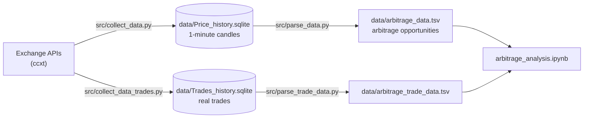

[Русский](README.md) | **English**

# Blockchain Arbitrage Analysis

[](https://www.python.org/)
[](https://github.com/ccxt/ccxt)
[](https://sqlite.org/)
[](https://nbviewer.org/github/whoIsClownHere/Blockchain-arbitrage-analysis/blob/main/arbitrage_analysis.ipynb)
[](LICENSE)

We collected 1-minute prices for every trading pair on six crypto exchanges for November 2022, found almost **one million arbitrage opportunities**, and tested two ways to profit from them: the classic one (buy → transfer → sell) and a new one (long + short without transferring the token).

The whole analysis is in one notebook: **[arbitrage_analysis.ipynb](arbitrage_analysis.ipynb)** (if GitHub fails to render it, open it in [nbviewer](https://nbviewer.org/github/whoIsClownHere/Blockchain-arbitrage-analysis/blob/main/arbitrage_analysis.ipynb)). The notebook and the presentation ([docs/presentation.pdf](docs/presentation.pdf)) are in Russian.

## Key results

| | |
|---|---|
| Period and data | November 1–30, 2022, 1-minute candles (OHLCV) |
| Exchanges | Binance, Huobi, MEXC, LBank, Bitrue, WhiteBIT |
| Arbitrage opportunities found | **976,521** |
| Average spread | **2.45%** |
| Average opportunity duration | **23 min 45 s** |
| Classic strategy, $100 × 1,000 trades per month | **$2,552 – $2,957** profit |
| New strategy, $100 × 1,000 trades per month | **$2,101 – $3,048** profit* |
| New strategy win rate | long **85.0%**, short **86.7%** |

Profit is the 95% interval of a simulation (random samples of 1,000 opportunities, many repeats), before fees.
\* Needs re-checking, see [Limitations](#limitations).

## How it works



### 1. Data collection

[src/collect_data.py](src/collect_data.py) downloads 1-minute candles for **all** pairs on an exchange using `fetch_ohlcv` from [ccxt](https://github.com/ccxt/ccxt). Each exchange runs in its own process, split into several asyncio groups of tickers. Request size and group count are tuned per exchange to stay under rate limits. Data goes into SQLite: one table per exchange with columns `ticker, date, open, highest, lowest, close, volume`.

[src/check_db_data.py](src/check_db_data.py) shows how many pairs failed to download.

### 2. Finding arbitrage opportunities

[src/parse_data.py](src/parse_data.py) goes through every minute of the month (43,200 minutes), every pair of exchanges and every common ticker:

- **Buy price** on exchange A is the minute's high; **sell price** on exchange B is the minute's low. This is a pessimistic estimate: we take the worst prices of the minute.
- **Spread** is how many percent $100 grows if you buy the token on A and sell it on B.
- Pairs quoted in BTC, ETH and SOL are converted to USD at the Binance rate, so all spreads are comparable.
- An opportunity is a **spread between 1% and 100%**. Consecutive minutes with such a spread are merged into one opportunity.

For each opportunity we store the average spread, start and end prices, start and end time, the ticker and the exchange pair. The result is small enough to keep in a TSV file that opens easily in pandas.

### 3. Real trades

[src/collect_data_trades.py](src/collect_data_trades.py) and [src/parse_trade_data.py](src/parse_trade_data.py) do the same using real trades instead of candles, for Binance and LBank on November 1, 2022. This checks whether the opportunities found in minute data are real.

## Results

### Exploratory analysis

**Spread over time.** Spreads appear throughout the month, with many large ones on November 8–11, during the FTX collapse.


| How often each spread occurs | Spread vs. duration |
|---|---|
|  |  |
| X is the number of opportunities, Y is the spread. A 1–1.5% spread is much more common than 4–4.5%. | The larger the spread, the longer the opportunity usually lasts. |

| Opportunity duration | Quote currencies |
|---|---|
|  |  |
| Of opportunities longer than 5 minutes, most last 5–30 minutes. | Most opportunities are in USDT pairs, then BTC and ETH. |

**Price convergence.** The difference between the token's final prices on the two exchanges is almost always near zero: prices converge by the end of an opportunity. The new strategy is built on this.


**Exchanges.** MEXC and Huobi are most often the best place to buy. The average spread is similar across exchanges: 1.5–1.9%.

| Opportunities by buy exchange | Average spread by buy exchange |
|---|---|
|  |  |

### Classic strategy

Buy the token where it is cheaper, transfer it to the other exchange and sell it there at a higher price. The transfer takes time, so the opportunity has to last at least 15 minutes.

- Opportunities lasting 3–15 minutes (the transfer will not finish in time): **220,557** — unprofitable.
- Opportunities lasting 15+ minutes: **158,446** — profitable.
- 1,000 trades of $100 per month bring **$2,552 – $2,957**.

### New strategy

Don't transfer the token. Open a long on the cheaper exchange and a short on the more expensive one, then wait for the prices to converge. No transfer wait, so shorter opportunities (2+ minutes) can be used.

| Long on the buy exchange | Short on the sell exchange |
|---|---|
|  |  |
| **85.0%** of trades are profitable | **86.7%** of trades are profitable |

Red dots are trades where the price moved against the position.

1,000 trades of $100 per month (USDT pairs only) bring **$2,101 – $3,048**: a wider range than the classic strategy, but a higher upper bound.

### Minute candles vs. real trades

The same slice (November 1, buying on Binance or LBank), from candles and from real trades:

| | Candles | Trades |
|---|---|---|
| Average spread | 1.71% | 1.31% |
| Average duration | 73 min | 27 min |

| How often each spread occurs (left: candles, right: trades) | Opportunities by time of day (left: candles, right: trades) |
|---|---|
|  |  |

In real trades spreads are smaller and last almost three times shorter. Some opportunities found in minute candles cannot be executed because of low liquidity, so the order book must be checked before trading.

## Limitations

- Profit does not include exchange fees, transfer fees or slippage.
- Minute candles overstate spread and duration compared with real trades.
- November 2022 was an unusual month because of the FTX collapse.
- In the new strategy's profit estimate, the short leg is valued by the starting spread and ignores price movement on exchange B during the trade. See the "Новая стратегия" section of the notebook.

## Repository structure

```
├── arbitrage_analysis.ipynb     # full analysis: EDA, both strategies, comparison with trades
├── src/
│   ├── collect_data.py          # 1-minute candles → data/Price_history.sqlite
│   ├── check_db_data.py         # checks how complete the collected data is
│   ├── parse_data.py            # finds opportunities → data/arbitrage_data.tsv
│   ├── collect_data_trades.py   # real trades → data/Trades_history.sqlite
│   ├── parse_trade_data.py      # opportunities from trades → data/arbitrage_trade_data.tsv
│   └── common.py                # shared paths and BTC/ETH/SOL → USDT conversion
├── data/                        # created by the scripts, not stored in git
├── images/                      # notebook charts and presentation diagrams
├── docs/presentation.pdf        # project presentation (Russian)
├── requirements.txt
└── LICENSE
```

## Running

```bash
git clone https://github.com/whoIsClownHere/Blockchain-arbitrage-analysis.git
cd Blockchain-arbitrage-analysis
pip install -r requirements.txt

python src/collect_data.py --exchanges binance huobi mexc lbank2 bitrue whitebit
python src/parse_data.py
python src/collect_data_trades.py
python src/parse_trade_data.py

jupyter notebook arbitrage_analysis.ipynb
```

By default the scripts use the study period (November 2022) and write everything to `data/`. Period, exchanges and paths are set with arguments; run `python src/<script>.py --help` for the full list. Collection takes a long time: it downloads history for every pair on every exchange, one process per exchange.

## Authors

- **Egor Ermakov** — [@whoIsClownHere](https://github.com/whoIsClownHere)
- **Mikhail Shershnev** — [@mish1ps](https://github.com/mish1ps)

Mentor: Dmitry.
