**Русский** | [English](README.en.md)

# Аналитика блокчейн-арбитража

[](https://www.python.org/)
[](https://github.com/ccxt/ccxt)
[](https://sqlite.org/)
[](https://nbviewer.org/github/whoIsClownHere/Blockchain-arbitrage-analysis/blob/main/arbitrage_analysis.ipynb)
[](LICENSE)

Собрали минутные цены всех торговых пар с шести криптобирж за ноябрь 2022, нашли почти **миллион арбитражных ситуаций** и проверили две стратегии заработка на них: классическую (купить → перевести → продать) и новую (long + short без перевода токена).

Весь анализ — в одном ноутбуке: **[arbitrage_analysis.ipynb](arbitrage_analysis.ipynb)** (если GitHub не отображает его, откройте через [nbviewer](https://nbviewer.org/github/whoIsClownHere/Blockchain-arbitrage-analysis/blob/main/arbitrage_analysis.ipynb)). Презентация — [docs/presentation.pdf](docs/presentation.pdf).

## Главное

| | |
|---|---|
| Период и данные | 1–30 ноября 2022, минутные свечи (OHLCV) |
| Биржи | Binance, Huobi, MEXC, LBank, Bitrue, WhiteBIT |
| Найдено арбитражных ситуаций | **976 521** |
| Средний spread | **2.45%** |
| Средняя длительность ситуации | **23 мин 45 с** |
| Классическая стратегия, $100 × 1000 сделок за месяц | **$2 552 – $2 957** прибыли |
| Новая стратегия, $100 × 1000 сделок за месяц | **$2 101 – $3 048** прибыли* |
| Успешность новой стратегии | long — **85.0%**, short — **86.7%** |

Прибыль — 95% интервал по симуляции (случайная выборка 1000 ситуаций, много повторов), без учёта комиссий.
\* Требует перепроверки, см. [Ограничения](#ограничения).

## Как это работает

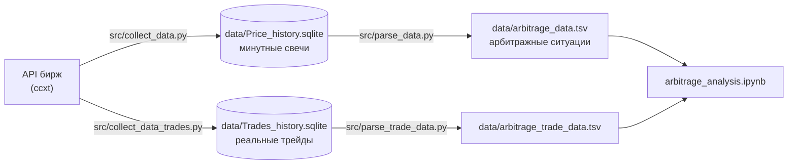

### 1. Сбор данных

[src/collect_data.py](src/collect_data.py) скачивает через `fetch_ohlcv` из [ccxt](https://github.com/ccxt/ccxt) минутные свечи по **всем** парам биржи. Каждая биржа обрабатывается в отдельном процессе, внутри — несколько asyncio-групп тикеров. Для каждой биржи подобраны размер запроса и число групп, чтобы не упираться в rate limit. Данные складываются в SQLite: одна таблица на биржу, колонки `ticker, date, open, highest, lowest, close, volume`.

[src/check_db_data.py](src/check_db_data.py) проверяет, по скольким парам данные не скачались.

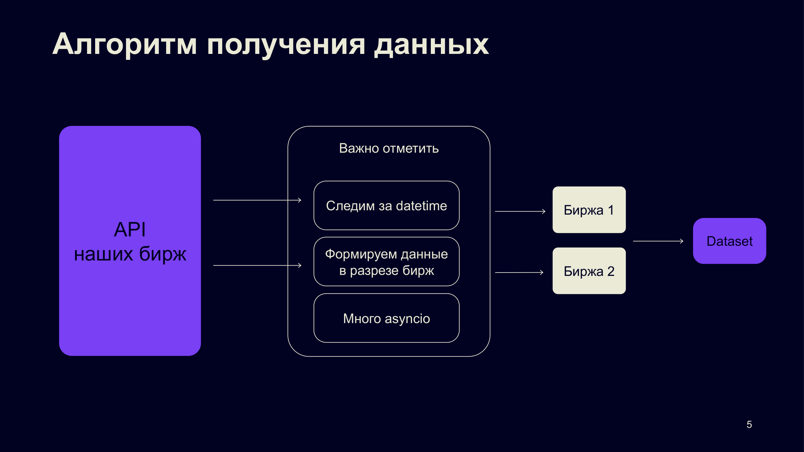

### 2. Поиск арбитражных ситуаций

[src/parse_data.py](src/parse_data.py) проходит по каждой минуте месяца (43 200 минут), каждой паре бирж и каждому общему тикеру:

- **Цена покупки** на бирже A — максимум минутной свечи, **цена продажи** на бирже B — минимум. Это пессимистичная оценка: берём худшие цены за минуту.
- **Spread** — на сколько процентов вырастут $100, если купить токен на A и продать на B.
- Пары к BTC, ETH и SOL переводятся в доллары по курсу на Binance, поэтому все спреды сравнимы.
- Ситуацией считаем **spread от 1% до 100%**. Подряд идущие минуты с таким спредом склеиваются в одну ситуацию.

Для каждой ситуации сохраняются средний spread, цены на старте и в конце, время начала и конца, тикер и пара бирж. Данных немного, поэтому результат пишется в TSV — его легко открыть в pandas.

### 3. Реальные трейды

[src/collect_data_trades.py](src/collect_data_trades.py) и [src/parse_trade_data.py](src/parse_trade_data.py) делают то же самое по реальным сделкам (а не свечам) для Binance и LBank за 1 ноября 2022. Это нужно, чтобы проверить, насколько ситуации на минутных данных реальны.

## Результаты

### Общая аналитика

**Spread во времени.** Спреды есть весь месяц, особенно много крупных — 8–11 ноября, во время краха FTX.

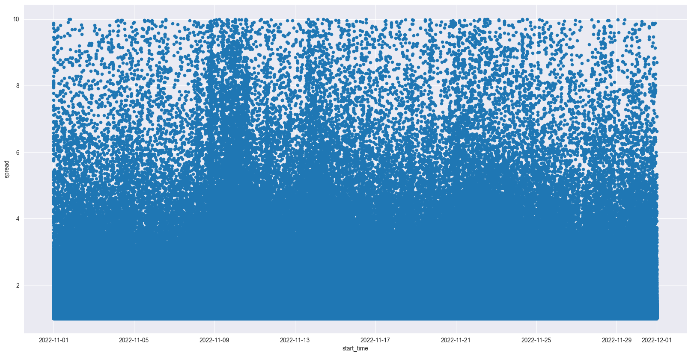

| Как часто встречается spread | Spread от длительности ситуации |
|---|---|
| 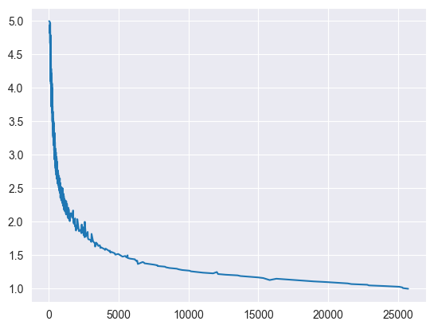 | 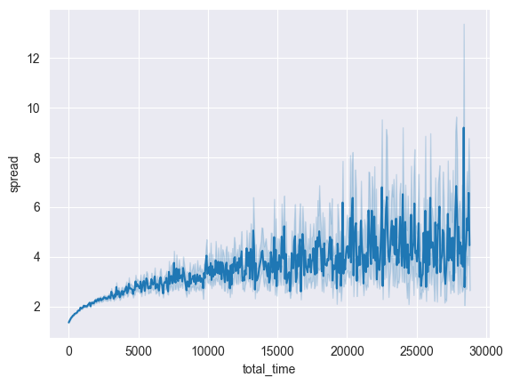 |
| По X — число ситуаций, по Y — spread. Spread 1–1.5% встречается намного чаще, чем 4–4.5%. | Чем больше spread, тем дольше обычно держится ситуация. |

| Длительность ситуаций | Котируемые валюты |
|---|---|
| 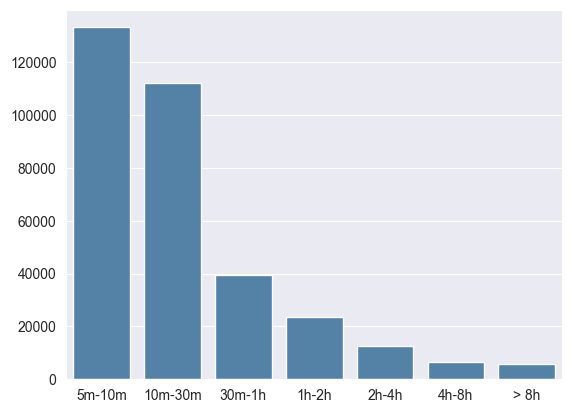 | 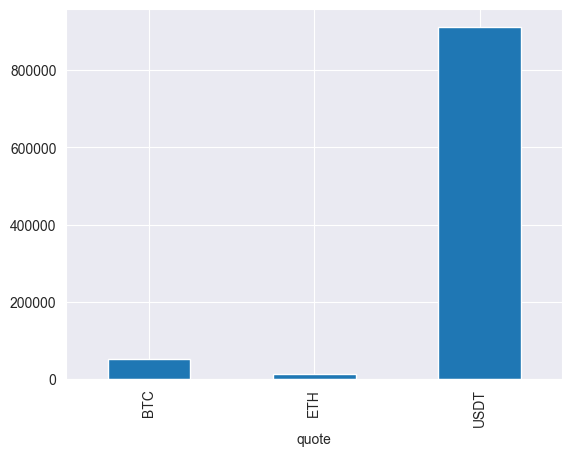 |
| Среди ситуаций дольше 5 минут большинство длится 5–30 минут. | Чаще всего арбитраж в парах к USDT, затем BTC и ETH. |

**Схождение цен.** Разница конечных цен токена на двух биржах почти всегда около нуля: к концу ситуации цены сходятся. На этом построена новая стратегия.

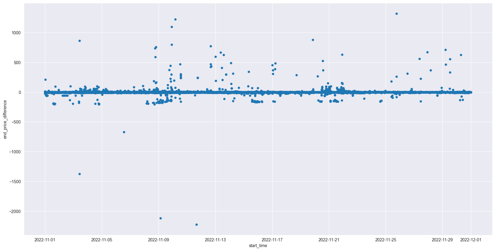

**Биржи.** Чаще всего выгодно покупать на MEXC и Huobi. Средний spread по биржам близок: 1.5–1.9%.

| Число ситуаций по бирже покупки | Средний spread по бирже покупки |
|---|---|
| 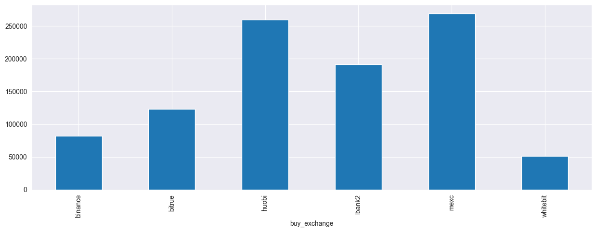 | 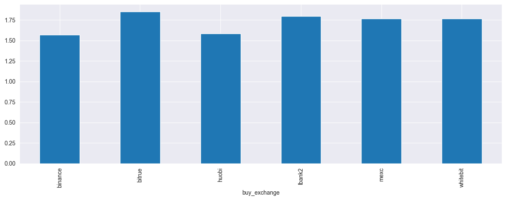 |

### Классическая стратегия

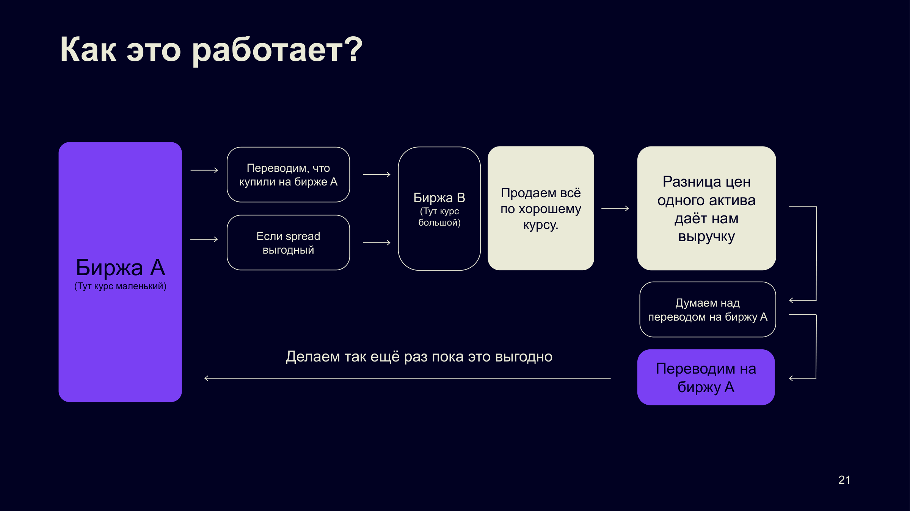

Покупаем токен там, где он дешевле, переводим на другую биржу и продаём дороже. Перевод занимает время, поэтому ситуация должна прожить хотя бы 15 минут.

- Ситуаций длительностью 3–15 минут (перевод не успеет): **220 557** — невыгодные.
- Ситуаций от 15 минут: **158 446** — выгодные.
- 1000 сделок по $100 за месяц приносят **$2 552 – $2 957**.

### Новая стратегия

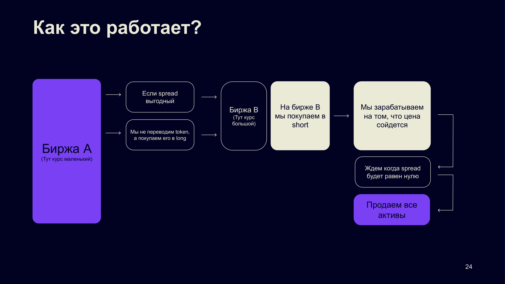

Токен не переводим. На дешёвой бирже открываем long, на дорогой — short, и ждём, пока цены сойдутся. Так не нужно ждать перевод, и можно брать короткие ситуации (от 2 минут).

| Long на бирже покупки | Short на бирже продажи |
|---|---|
| 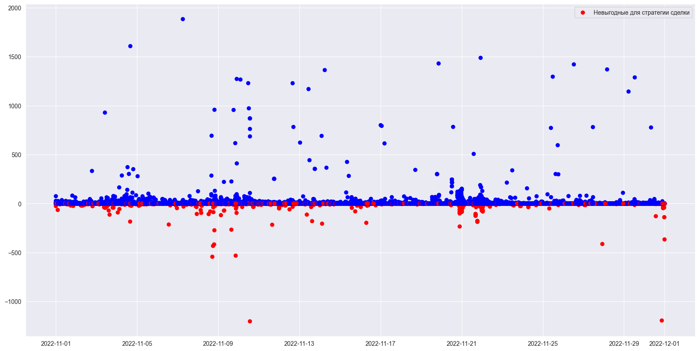 | 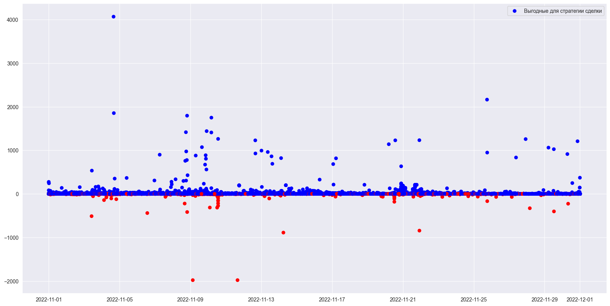 |
| **85.0%** сделок успешны | **86.7%** сделок успешны |

Красные точки — сделки, где цена пошла против позиции.

1000 сделок по $100 за месяц (только пары к USDT) приносят **$2 101 – $3 048**: разброс шире, чем у классической, но верхняя граница выше.

### Минутные свечи против реальных трейдов

Сравнили одинаковый срез (1 ноября, покупка на Binance или LBank) по свечам и по реальным сделкам:

| | Свечи | Трейды |
|---|---|---|
| Средний spread | 1.71% | 1.31% |
| Средняя длительность | 73 мин | 27 мин |

| Как часто встречается spread (слева свечи, справа трейды) | Ситуации по времени суток (слева свечи, справа трейды) |
|---|---|
| 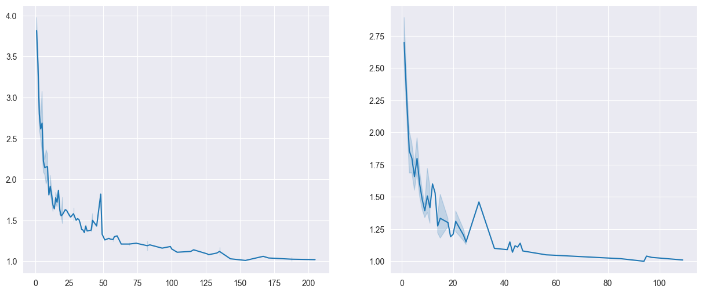 | 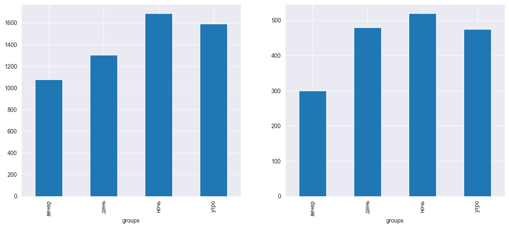 |

По реальным сделкам спреды меньше и живут почти втрое короче. Часть ситуаций на минутных свечах нереализуема из-за низкой ликвидности, поэтому перед сделкой нужно проверять стакан.

## Ограничения

- Прибыль считается без комиссий бирж, комиссии за перевод и проскальзывания.
- Минутные свечи завышают спред и длительность ситуаций по сравнению с реальными трейдами.
- Ноябрь 2022 — нетипичный месяц из-за краха FTX.
- В оценке прибыли новой стратегии short-часть считается по спреду на старте, без учёта движения цены на бирже B за время сделки. Подробности — в ноутбуке, в разделе «Новая стратегия».

## Структура репозитория

```
├── arbitrage_analysis.ipynb     # весь анализ: общая аналитика, обе стратегии, сравнение с трейдами
├── src/
│   ├── collect_data.py          # сбор минутных свечей → data/Price_history.sqlite
│   ├── check_db_data.py         # проверка полноты собранных данных
│   ├── parse_data.py            # поиск арбитражных ситуаций → data/arbitrage_data.tsv
│   ├── collect_data_trades.py   # сбор реальных трейдов → data/Trades_history.sqlite
│   ├── parse_trade_data.py      # поиск ситуаций по трейдам → data/arbitrage_trade_data.tsv
│   └── common.py                # общие пути и пересчёт BTC/ETH/SOL в USDT
├── data/                        # создаётся скриптами, не хранится в git
├── images/                      # графики из ноутбука и схемы из презентации
├── docs/presentation.pdf        # презентация проекта
├── requirements.txt
└── LICENSE
```

## Запуск

```bash
git clone https://github.com/whoIsClownHere/Blockchain-arbitrage-analysis.git
cd Blockchain-arbitrage-analysis
pip install -r requirements.txt

python src/collect_data.py --exchanges binance huobi mexc lbank2 bitrue whitebit
python src/parse_data.py
python src/collect_data_trades.py
python src/parse_trade_data.py

jupyter notebook arbitrage_analysis.ipynb
```

По умолчанию скрипты берут период исследования (ноябрь 2022) и складывают всё в `data/`. Период, биржи и пути меняются аргументами, полный список — `python src/<скрипт>.py --help`. Сбор идёт долго: скачивается история по всем парам каждой биржи, и для каждой биржи запускается отдельный процесс.

## Авторы

- **Егор Ермаков** — [@whoIsClownHere](https://github.com/whoIsClownHere)
- **Михаил Шершнев** — [@mish1ps](https://github.com/mish1ps)

Ментор — Дмитрий.
